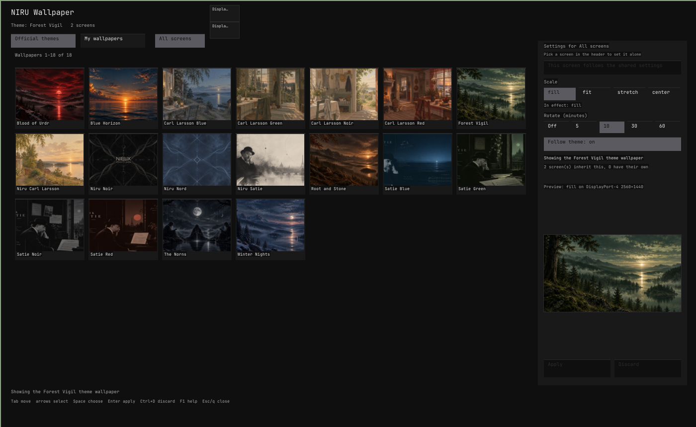

# NIRU Wallpaper

Wallpaper picker with previews and per-screen choices for the NIRUX X11 desktop.

**Status: beta** · Part of the [NIRUX](https://github.com/nirucon/nirux) suite · [MIT License](LICENSE)



## About

NIRU Wallpaper (`niruwallpaper`) is a small X11 settings window for the NIRUX
wallpaper, with picture previews and a choice per screen. It owns no settings
of its own.

NIRUWM applies and rotates the wallpaper. This program is a front end for that:
it reads what `niructl` reports and every change goes back out through
`niructl`. There is no wallpaper daemon, no second configuration file and no
parser of the theme directory here, so the window cannot disagree with the
window manager about what is shown.

## Features

- **Follow the theme:** use the selected NIRUX theme's own wallpaper, so a
  theme change also changes the wallpaper.
- **Choose a theme wallpaper:** keep the current theme but show another
  picture from the installed set, including the Carl Larsson and Erik Satie
  colour variants after `nirux wallpapers download extras` (listed under
  **Official themes**).
- **Choose your own picture** from `~/Pictures/Wallpapers` (or the directory
  configured in `niruwm/config.toml`).
- **Add pictures:** under **My wallpapers**, *Add pictures…* lists the PNG,
  JPEG, WebP and BMP files directly in your Pictures and Downloads folders
  (localized names from `user-dirs.dirs` included), newest first. Marked files
  are **copied** into the wallpaper directory; originals are never moved, and a
  taken name gets `-2`, `-3`, … *Open folder* opens the directory with
  `xdg-open`.
- **Set one screen alone:** with more than one screen, a small map of the
  screens lets you give one screen its own picture; a corner mark shows which
  screens have one.
- **See the scale before applying:** the panel previews the staged picture on
  the chosen screen's shape for `fill`, `fit`, `stretch` or `center`.
- Rotation interval, including off.
- Fast previews from background workers, cached in memory and on disk.
- No polling: inotify, RandR and NIRUWM events trigger a refresh; an idle
  window starts no process and does not wake up.
- Follows the active theme live, including `appearance.toml` overrides.

## Requirements

- X11 and a running NIRUX session: `niructl` and NIRUWM with
  `[wallpaper] enabled = true` (NIRUX sets this on install).
- Debian, Arch and Void glibc, x86_64. The release binary is static (musl);
  there is no GTK or Qt runtime requirement.

## Installation

### With NIRUX

NIRU Wallpaper is a core component: `nirux install` and `nirux update` install
and update it from the pinned manifest, together with its desktop entry and
icon. Open it from NIRU Launcher (**Wallpaper**) or run `niruwallpaper`.

### Standalone

Not supported on its own: it needs `niructl` and NIRUWM. Each release carries
`niruwallpaper`, `niruwallpaper.desktop`, `niruwallpaper.png` and
`SHA256SUMS`.

## Usage

```sh
niruwallpaper              # open the window
niruwallpaper status       # the settings and each screen's state
niruwallpaper list         # available wallpapers, one per line
niruwallpaper set PATH     # apply one picture to the shared settings
niruwallpaper --version
niruwallpaper --help
```

| Key | Action |
|---|---|
| `Tab` / `Shift+Tab` | Move between every control; the focus ring shows where you are |
| Arrows | Choose a picture in the grid |
| `PageUp` / `PageDown`, `Home` / `End` | Move a page, or to the first or last picture |
| `Space` | Choose the picture, or press the focused control |
| `Enter` | Apply, or press the focused control |
| `Ctrl+D` | Discard the staged change |
| `A` | Return to the picture grid |
| `F1` | Show or hide help |
| `Esc` or `q` | Close |

The mouse wheel scrolls the grid by a row (with `Shift`, by a page); it never
chooses a picture. Only the left button presses controls. The range and total
above the grid (wallpapers 1 to 16 of 24, for example) say where you are, and the thin scrollbar can be dragged or
clicked. The status line names the picture each connected screen shows, and
says when no running window manager confirmed the result.

Narrower than 660 pixels (a tiled column), the settings panel moves below the
grid. Keys work on every keyboard layout, with Shift, AltGr and Caps Lock
resolved as in NIRU Launcher.

**Apply** runs in the background: the window says "Applying…" and keeps
answering while NIRUWM composes each screen (seconds for an 8K picture on
several monitors). `niructl` gets 30 seconds for an Apply and 10 for a
question; a command that does not answer by then is stopped and the staged
change is kept. A staged, unapplied change is never replaced by a refresh; the
footer says when the desktop changed meanwhile.

### How the screens behave

These are the rules the window shows and NIRUWM enforces:

- The default is the **same picture on every screen**, scaled and cropped for
  each screen's own size. One picture is never stretched across the whole
  desktop.
- A screen may have **its own picture**. Choosing one stores an entry for that
  screen only; it survives a theme change, a reload, a rotation tick and a
  reconnect, and only its own entry or the reset button changes it.
- New screens inherit the shared settings. An unplugged screen keeps its entry,
  so the same cable in the same port brings its picture back.
- Screens are identified by their **RandR output name** (`eDP-1`, `HDMI-1`): a
  cable moved to another port is a different screen.
- Two mirrored outputs share one display area and show the same picture.
- A theme without a picture paints its own background colour on the screens
  that follow it.
- A single picture (`mode = "single"`) keeps one image, so rotation is shown as
  inactive instead of silently doing nothing.

## Configuration

Every setting lives in `~/.config/niruwm/config.toml` and is written only by
`niructl`. NIRU Wallpaper watches that file, `appearance.toml`, `themes/`, the
wallpaper directory and the theme wallpaper directories, and reads the desktop
again 300 ms after a change, when it regains focus, on monitor hotplug and when
NIRUWM publishes what it rendered.

`NIRUWALLPAPER_NIRUCTL=/path/to/niructl` makes the window use another `niructl`
(the Xvfb test uses it).

## Files and paths

| Path | Purpose |
|---|---|
| `~/.config/niruwm/config.toml` | Every wallpaper setting, written only by `niructl` |
| `~/Pictures/Wallpapers` | Default directory for your own pictures |
| `$XDG_CACHE_HOME/niruwallpaper/thumbs-v2` | Regenerable preview cache |

Previews are keyed on the file's path, size, modification time and a sample of
its content, so a replaced file never shows a stale picture. PNG, JPEG, WebP
and BMP are previewed; anything else says "cannot read image". The program
never modifies, moves or deletes an image.

## Troubleshooting

- **`the niructl command was not found`:** NIRUX is not installed, or this is
  not a NIRUX session. The window and `status` need NIRUX.
- **`NIRUWM does not own the wallpaper`:** `[wallpaper] enabled = false` in
  `~/.config/niruwm/config.toml`. Enable it; NIRUX does this on install.
- **A screen shows its theme colour:** that theme has no picture installed;
  `nirux wallpapers download` installs the optional set.
- **Rotation does nothing:** a single picture keeps one image. Choose the theme
  or another picture and set an interval.

## Uninstall

NIRU Wallpaper is removed with the rest of the suite by `nirux uninstall`.
Delete `~/.cache/niruwallpaper` to drop the preview cache; your pictures are
not touched.

## Building from source

Rust 1.85 or newer.

```sh
cargo build --release --locked
cargo test --locked
sh tests/cli-smoke.sh target/release/niruwallpaper
# The window under Xvfb against a fixture niructl (needs Xvfb, xdotool, xwd):
cargo test --locked --test xvfb -- --ignored
```

Dependencies are the ones the suite already uses: `x11rb` for X11 and RandR,
`image` for previews and `ab_glyph` for text. Changes should preserve NIRUWM's
ownership of wallpaper state and use the existing `niructl` interface.

## Status, disclaimer and how it's made

**Status: beta.** It is how I pick wallpapers on every NIRUX machine; it is
only as capable as the `niructl` wallpaper interface behind it.

NIRUX and every niru* project are made by me, Nicklas Rudolfsson
([@nirucon](https://github.com/nirucon)), for me. They are tailored to my own
needs, preferences and workflows, on my own machines. If they fit yours too,
that's a nice bonus.

- **Free and open source.** Anyone is free to use, study, change and share
  it under the [MIT License](LICENSE).
- **No guarantees.** There is no warranty of any kind. Use it at your own
  risk, read what you install and keep backups of anything that matters.
- **How it's made.** Some of these projects I built from scratch by hand. In
  more recent releases I have used Claude, Anthropic's AI, to do much of the
  heavy lifting under my direction: I decide what to build and how it should
  behave, and I test it on my own machines. It saves me a lot of time, and
  the result is quite OK.
- **Alpha, beta, dev, and maybe forever.** Most things here are alpha, beta
  or dev, and may stay that way. Maybe one day there will be a real stable
  release, but given how fast development moves, and how I am as a person,
  maybe never :)

| Label | Meaning |
|---|---|
| dev | Under active construction; may not build, install or work yet. |
| alpha | Works on my machines, but incomplete or rough; expect breaking changes. |
| beta | In daily use on my machines and mostly complete; rough edges remain. |

## License

MIT License, see [LICENSE](LICENSE). Copyright (c) 2026 Nicklas Rudolfsson.
